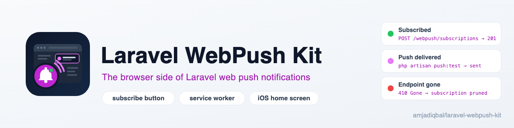
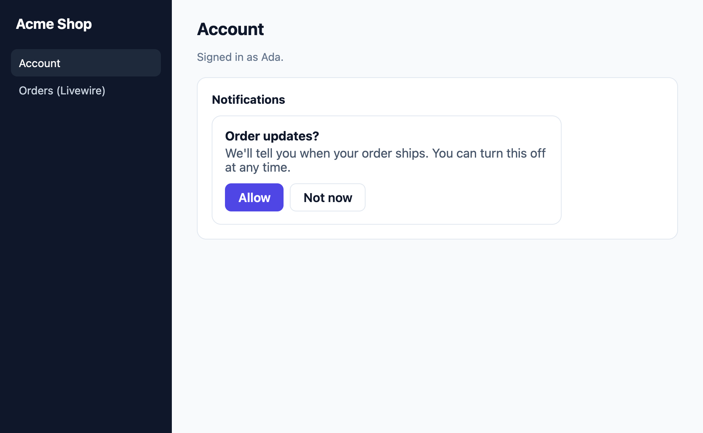

<p align="center">
  <picture>
    <source media="(prefers-color-scheme: dark)" srcset="art/banner-dark.png">
    
  </picture>
</p>

# Laravel WebPush Kit: browser push notifications for Laravel

[`laravel-notification-channels/webpush`](https://github.com/laravel-notification-channels/webpush)
sends web push notifications from Laravel. Everything that happens in the browser is left to you: the
service worker, the Push API subscribe and unsubscribe calls, the permission prompt, saving the
subscription, and the iPhone rules. This package covers that part:

- a **Blade and Livewire subscribe button** with a polite two-step permission prompt. The browser's own
  prompt only appears after the user says yes on your page;
- a **service worker** that shows normal and **declarative web push** messages, and sets the page a click
  should open (clicking a delivered notification is not tested yet, see Browser support);
- **routes** that save and delete the signed-in user's subscription through the channel's own
  `updatePushSubscription()` and `deletePushSubscription()`;
- **iPhone and iPad guidance**: Add to Home Screen when it's needed, plus an optional web app manifest;
- **subscriptions that stay alive**: the service worker re-subscribes when the browser rotates a subscription,
  and a page with the button re-syncs it once per browser tab session;
- **`php artisan push:test`**, which sends a real push and shows what each push service answered, including
  dead subscriptions the channel removes on 404 and 410.

Docs and demo: https://amjad.com.pk/laravel/packages/laravel-webpush-kit

[](https://packagist.org/packages/amjadiqbal/laravel-webpush-kit)
[](https://packagist.org/packages/amjadiqbal/laravel-webpush-kit)
[](LICENSE.md)

<p align="center">
  
</p>

```blade
<x-webpush-kit::button />
```

```bash
php artisan push:test
```

## Requirements

- PHP 8.3 or newer, Laravel 12 or 13
- `laravel-notification-channels/webpush` 11, 12 or 13 (installed with this package)
- HTTPS in production. Browsers allow push on `localhost` without it.

## Browser support

Tested in Chrome with Google's push service: subscribing and turning off from the button, normal and
declarative pushes, a real 410 removing a dead subscription, Livewire and `wire:navigate`, and the
blocked state. **Not tested yet:** clicking a delivered notification (the click target is set and checked,
but the macOS banner never appeared on the test machine), Firefox, and Safari on macOS and iOS. Reports
from those browsers are welcome in the [issues](https://github.com/amjadiqbal/laravel-webpush-kit/issues).

## Installation

```bash
composer require amjadiqbal/laravel-webpush-kit
```

If you haven't set up the channel yet, do that first. It takes three commands:

```bash
php artisan vendor:publish --provider="NotificationChannels\WebPush\WebPushServiceProvider" --tag=migrations
php artisan migrate
php artisan webpush:vapid
```

Then add the channel's trait to your user model:

```php
use NotificationChannels\WebPush\HasPushSubscriptions;

class User extends Authenticatable
{
    use HasPushSubscriptions, Notifiable;
}
```

Set a contact for the push services in `.env`. Apple's push service rejects a push whose VAPID subject isn't a
`mailto:` or `https:` URL, and `push:test` warns when yours looks wrong:

```dotenv
VAPID_SUBJECT=mailto:you@yourdomain.com
```

## Usage

### The subscribe button

Put the button anywhere a signed-in user can see it. Guests see nothing.

```blade
<x-webpush-kit::button />
```

Clicking it doesn't open the browser's permission dialog straight away. It first shows a short card that
says what the notifications are for. Only **Allow** asks the browser. **Not now** closes the card, and
the browser's one-time prompt isn't used up on someone who wasn't ready. That matters because once a
user blocks notifications, a site can't ask again.

| Prop | Default | |
|---|---|---|
| `title` | "Get notified?" | Heading of the card |
| `body` | "We will send a notification when…" | What the notifications are for |
| `prompt` | `click` | `auto` shows the card by itself after `delay` seconds |
| `delay` | `5` | Seconds before the `auto` card appears |
| `remind-after-days` | `7` | After **Not now**, how long `auto` stays quiet |
| `theme` | page | `dark`, or `auto` to follow the system. By default it's dark inside `.dark` or `[data-theme="dark"]` |

```blade
<x-webpush-kit::button
    prompt="auto"
    title="Order updates?"
    body="We'll tell you when your order ships. You can turn this off at any time."
/>
```

The button shows the right thing in every state: the offer, **Turn off notifications** once subscribed,
how to unblock a blocked site, a note on browsers without push, and the Home Screen steps on iPhone and
iPad.

### Livewire

The button works inside Livewire components and across `wire:navigate`. It keeps its own state
(`wire:ignore`), and the script loads once (`data-navigate-once`). The button fires browser events you can
listen for:

```blade
<div x-on:webpush-kit:subscribed.window="$wire.$refresh()">
    <x-webpush-kit::button />
</div>
```

`webpush-kit:subscribed` and `webpush-kit:unsubscribed` both carry `detail.endpoint`.

### Sending notifications

Send notifications with the channel as usual. To set the page a click opens, put its URL in `data.url`. Each
action can set its own page through `data.actions`. (The service worker's click handling is not tested in a
real browser yet.)

```php
use NotificationChannels\WebPush\WebPushChannel;
use NotificationChannels\WebPush\WebPushMessage;

public function via($notifiable): array
{
    return [WebPushChannel::class];
}

public function toWebPush($notifiable, $notification): WebPushMessage
{
    return (new WebPushMessage)
        ->title('Your order shipped')
        ->body('Order #1042 is on its way.')
        ->icon('/icon-192.png')
        ->action('Track it', 'track')
        ->data([
            'url' => route('orders.show', 1042),
            'actions' => ['track' => route('orders.track', 1042)],
        ]);
}
```

### Declarative web push

According to WebKit, Safari on iOS and iPadOS 18.4 and macOS 15.5 can show a **declarative web push** message
with no service worker running (not tested with this package yet). Other browsers still need a service
worker, and the kit's reads the same message: in Chrome a declarative push is delivered and shown by it
(tested). One notification covers both:

```php
use NotificationChannels\WebPush\DeclarativeWebPushMessage;

public function toWebPush($notifiable, $notification): DeclarativeWebPushMessage
{
    return (new DeclarativeWebPushMessage)
        ->title('Your order shipped')
        ->body('Order #1042 is on its way.')
        ->navigate(route('orders.show', 1042))
        ->action('Track it', 'track', route('orders.track', 1042));
}
```

### iPhone and iPad

iOS and iPadOS 16.4+ only allow web push for a site added to the Home Screen, and the site needs a web app
manifest whose `display` is `standalone` or `fullscreen`. In Safari, the button explains this instead of
failing. None of this is tested on an iPhone or iPad yet.

If your app has no manifest yet, turn on the kit's and add the head tags. `<x-webpush-kit::head />` always
emits the `mobile-web-app-capable` and `apple-mobile-web-app-capable` meta tags and the kit's script; the
manifest link only when the manifest is on:

```dotenv
WEBPUSH_KIT_MANIFEST=true
```

```blade
<head>
    <x-webpush-kit::head />
</head>
```

Set the name, colours, icons and `display` (`standalone` or `fullscreen`) under `manifest` in
`config/webpush-kit.php`.

### Testing a push

```bash
php artisan push:test                  # the user with the newest subscription
php artisan push:test 42               # user 42
php artisan push:test --url=/orders    # the page a click should open
php artisan push:test --declarative    # a declarative web push message
php artisan push:test --title="Hi" --body="It works"   # your own text
php artisan push:test --model="App\Models\Admin"       # another notifiable model
```

```
  INFO  Sending to 2 subscription(s) of User #1.

+-----------------------------------+--------+-------------------------------+
| Push service                      | Status | Result                        |
+-----------------------------------+--------+-------------------------------+
| fcm.googleapis.com                | 201    | delivered                     |
| updates.push.services.mozilla.com | 410    | expired: subscription removed |
+-----------------------------------+--------+-------------------------------+
```

It checks the VAPID keys and `VAPID_SUBJECT` first, then sends through the channel. It exits non-zero when
nothing was delivered. When a push service answers 404 or 410, the channel deletes that subscription;
the table shows when that happened.

`php artisan about` shows the kit's version, whether the VAPID keys are set, and whether `VAPID_SUBJECT`
passes the same checks as `push:test` (`ok`, or `check` when it doesn't).

## Configuration

```bash
php artisan vendor:publish --tag=webpush-kit-config
```

| Key | Default | |
|---|---|---|
| `routes.prefix` | `webpush` | The kit's routes: `POST`/`DELETE /webpush/subscriptions`, `POST /webpush/subscriptions/rotate`, `GET /webpush/webpush-kit.js` |
| `routes.middleware` | `['web', 'auth']` | Middleware for the subscription routes |
| `routes.domain` | `null` | A domain for all of the kit's routes, including the service worker and manifest |
| `guard` | `null` | The auth guard the button checks |
| `service_worker.path` | `webpush-sw.js` | Where the service worker is served (at the site root, so it can control every page) |
| `service_worker.scope` | `/` | Its scope |
| `service_worker.register` | `true` | `false` if your app registers its own service worker (see below) |
| `manifest.*` | off | The optional web app manifest |
| `notifiable` | users provider model | The model `push:test` sends to |

Texts are translatable: `php artisan vendor:publish --tag=webpush-kit-translations`. The button's colours
are CSS variables (`--wpk-accent`, `--wpk-accent-text`, `--wpk-text`, `--wpk-muted`, `--wpk-surface`,
`--wpk-border`). Dark mode follows the
page (`.dark` or `data-theme="dark"` on a parent), or the system with `theme="auto"`.

### Already have a service worker?

A scope can only have one service worker. If your app (a PWA plugin, Workbox) already registers one at `/`,
set `service_worker.register` to `false` and load the kit's code inside yours:

```js
self.WEBPUSH_KIT = { rotateUrl: '/webpush/subscriptions/rotate', vapidKey: 'your VAPID public key' };
importScripts('/webpush-sw.js');
```

To change the service worker itself, publish it to `public/`. The web server then serves that file
instead of the route:

```bash
php artisan vendor:publish --tag=webpush-kit-service-worker
```

## How it works

- **Subscribe**: on **Allow**, the button calls `Notification.requestPermission()` inside the click
  (browsers ignore it otherwise), then `pushManager.subscribe({ userVisibleOnly: true, applicationServerKey })`
  with your VAPID key. It posts `PushSubscription.toJSON()` and the browser's content encoding to the
  subscriptions route, which calls `updatePushSubscription()`. If another user had that endpoint, the
  channel moves it to the user who just subscribed.
- **Unsubscribe**: `DELETE` to the server (`deletePushSubscription()`), then `subscription.unsubscribe()`.
- **Staying in sync**: once per browser tab session (`sessionStorage`), a page with the button saves the
  current subscription again, so a row the server lost comes back. When the push service rotates a subscription, the
  `pushsubscriptionchange` handler subscribes again and replaces the old endpoint through the rotate route.
  The rotate route has no CSRF token (a service worker can't read one), so it only accepts same-origin
  requests from a signed-in user, and only removes endpoints that user owns.
- **Showing**: every push is shown. Safari revokes permission for a push that shows nothing.

## Testing

```bash
composer test
scripts/ci-local.sh   # PHP 8.3-8.5 x Laravel 12-13, plus the oldest supported channel; Pest, Pint, PHPStan
```

## Need this built into your app, or something custom?

I build Laravel features end to end, including notifications across email, SMS and push, PWAs, and the
packages around them. If you want web push set up in your app, or need something this package doesn't do,
[get in touch](https://amjad.com.pk/contact?utm_source=github&utm_medium=readme&utm_campaign=laravel-webpush-kit).

## Support

- 🐛 **Bug or feature request**: [open an issue](https://github.com/amjadiqbal/laravel-webpush-kit/issues)
- 🔒 **Security issue**: please report privately via GitHub's security tab

## Need this customised, or something built?

I'm available for custom development, package integration, and technical consulting.

[](https://www.upwork.com/freelancers/amjadkhatri)

## More packages

Part of a family of open-source packages. See [all of them](https://github.com/amjadiqbal?tab=repositories).

| | |
|---|---|
| [laravel-mysql-advisor](https://github.com/amjadiqbal/laravel-mysql-advisor) | MySQL and MariaDB health checks with the fix SQL |
| [kiln](https://github.com/amjadiqbal/kiln) | Deploy-time OPcache control for Laravel |
| [laravel-driver-js](https://github.com/amjadiqbal/laravel-driver-js) | Product tours and onboarding for Laravel |
| [laravel-logpulse](https://github.com/amjadiqbal/laravel-logpulse) | Log health monitoring and alerting |

## Changelog

See [CHANGELOG.md](CHANGELOG.md).

## License

MIT. See [LICENSE.md](LICENSE.md). This package is independent and not affiliated with the
laravel-notification-channels project.
